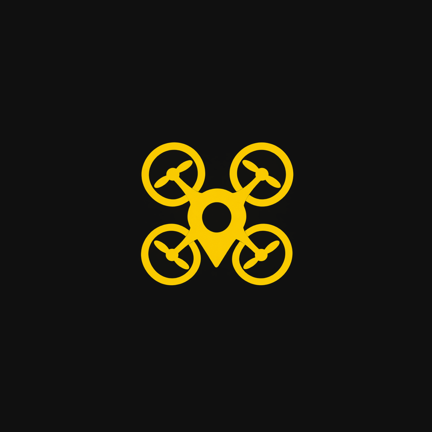

  

<h1 align="center">DronGPX</h1>

  Escanea el QR del dron, abre el punto en Maverick. Sin internet, sin cuentas, en menos de 5 segundos.

## Qué hace

Cuando el control de tu dron comparte una ubicación como código QR, DronGPX la lee con la cámara,
arma un archivo GPX con ese punto y lo abre directo en **Maverick** para que quede marcado en el mapa.
Todo el proceso ocurre en el teléfono: no se usa internet en ningún paso.

## Cómo se usa

1. Abre DronGPX. La app entra directo a la cámara, lista para escanear.
2. Apunta al QR que te muestra el control del dron.
3. Listo: Maverick se abre solo, mostrando el punto marcado.
4. Al volver a DronGPX (botón atrás o multitarea), la cámara ya está lista para el siguiente punto.

No hace falta tocar nada entre un punto y el siguiente, salvo la primera vez que el sistema pida el
permiso de cámara.

## Qué QR puede leer

Cualquiera de estos formatos sirve, siempre que traiga una coordenada válida:

- Un link de Google Maps compartido desde el control del dron (lo más común).
- Un link con `/@lat,lon` (vista de mapa).
- Un código con esquema `geo:lat,lon`.
- Texto plano con la coordenada, tipo `-52.746968, -71.363613`.

Si el QR no trae una coordenada reconocible, o los números están fuera de rango, la app te muestra
el contenido leído y un mensaje de error en vez de abrir Maverick con datos incorrectos.

## Dónde queda guardado el punto

Cada punto escaneado se guarda como un archivo `.gpx` individual, nombrado con la fecha y hora del
escaneo (por ejemplo `dron_2026-11-05_143205.gpx`), y además se intenta copiar a
**Descargas/DronGPX** en el teléfono para que puedas encontrarlo o compartirlo después.

> En teléfonos con Android 9 o anterior, la copia a Descargas puede no aparecer — la app no pide
> permiso de almacenamiento a propósito, solo permiso de cámara. El punto igual se abre en Maverick
> sin problema.

## Si Maverick no está instalado

DronGPX necesita [Maverick Pro](https://play.google.com/store/apps/details?id=com.codesector.maverick.full)
instalado para mostrar el punto automáticamente. Si no lo encuentra, te lo avisa en pantalla y te deja
elegir otra app para abrir el archivo GPX desde un selector.

## Permisos

DronGPX solo pide permiso de **cámara**, necesario para escanear el QR. La app no se conecta a
internet: no tiene permiso de red, no usa cuentas, no manda datos a ningún servidor.

## Requisitos

- Android 8.0 (API 26) o superior.
- Maverick Pro instalado, para que el punto se abra automáticamente al escanear.

## Instalación

DronGPX no se distribuye por Google Play. Instala el APK directamente en el teléfono (sideload) y
permite la instalación desde "orígenes desconocidos" cuando el sistema lo pida.
